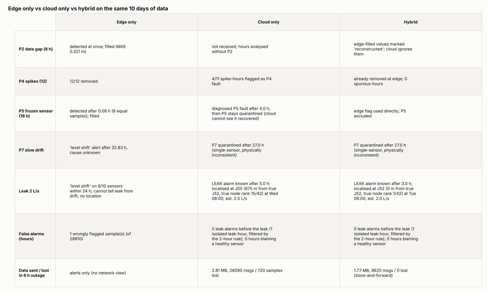
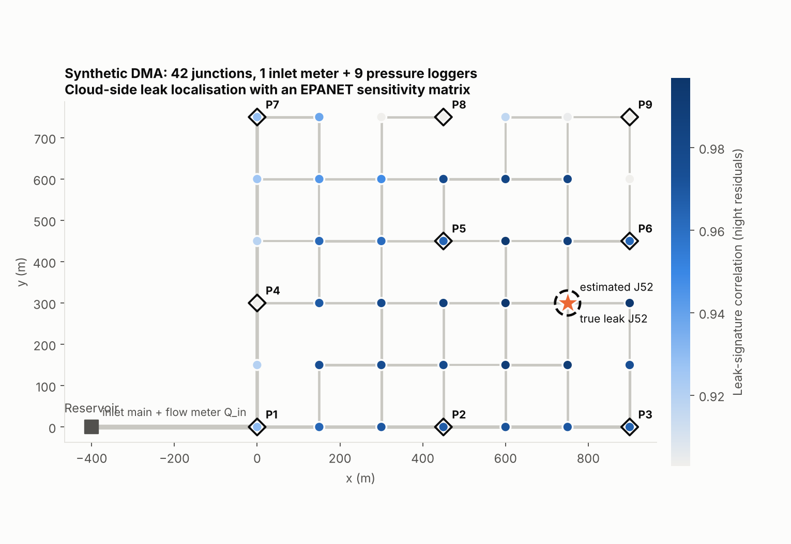
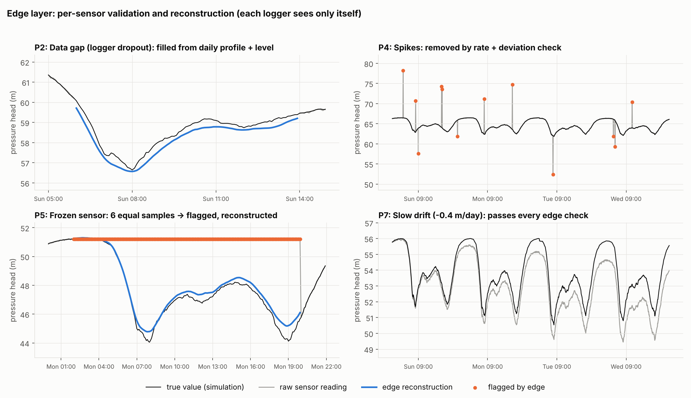
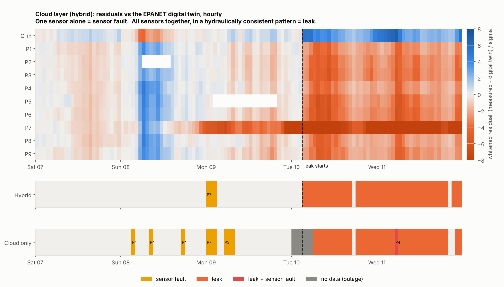

# Mining the Flow: edge vs cloud validation of water-network IoT data

> **Status: preliminary experiment on synthetic data.** I built this small prototype
> to explore the research questions of the i3WaterS doctoral position **DC11 "Mining the
> Flow"** (UPC): validating IoT water-network data at the edge, reasoning about it in the
> cloud with a hydraulic model, and measuring what each side is good at. All data is
> simulated (a synthetic District Metered Area in WNTR/EPANET). It is a learning and
> exploration exercise, not a validated method or a result on real network data.



## Key results at a glance

* **Hybrid (edge + cloud)** raised the leak alarm **3 h after onset** and localised the
  2 L/s leak **at the true node (rank 1/42)**, with its size estimated at **2.0 L/s**.
* **Edge validation** removed **12/12 spikes**, flagged a frozen sensor within **30 min**,
  and reconstructed an 8 h gap with **MAE 0.32 m** (vs 1.7 m last-value hold, 1.3 m linear interpolation).
* **Cloud only** (raw data) was thrown off by one unfiltered spike, which moved the leak
  estimate **875 m** away, and it lost the first leak night to a 6 h backhaul outage.
* **Edge only** could not tell a slow sensor drift from a leak (both look like a level shift).
* Hybrid used **37% less bandwidth** (1.77 vs 2.81 MB) and **66% fewer messages**, with 0 samples lost.
* Over 28 random leak scenarios, a 2 L/s leak lands in the top 5 candidate nodes **93%**
  of the time (exact node 57%), so the honest claim is "localises to a small area".

Main limitations: the hydraulic twin is perfect apart from demand, the leak is modelled as
a constant demand, and the network is synthetic. See [limitations](#honest-limitations-what-id-do-next-in-the-phd).

## What it covers

It follows the three DC11 objectives:

| DC11 objective | In this prototype |
|---|---|
| 1. Distributed validation and reconstruction | `edge.py`: one tiny streaming validator per logger (range, rate, spike, flatline checks; gap filling; CUSUM change alarm). About 2.5 kB of parameters per sensor. |
| 2. IoT analytics with hydraulic models | `cloud.py`: an EPANET digital twin (via WNTR), residuals, a leak sensitivity matrix, and an hourly hypothesis test: *sensor fault vs leak*. |
| 3. Integration and comparison | `run_demo.py`: the same 10 days run as **edge only**, **cloud only** and **hybrid**, compared on detection, delay, false alarms, bandwidth and an outage. Data travels as OGC SensorThings Observations over MQTT-style topics (`iot.py`). |

## Running it

**Requirements:** Python 3.12 or newer recommended (developed on 3.12+). Dependencies are in `requirements.txt` (WNTR, NumPy, pandas, Matplotlib, NetworkX, SciPy).

```
python -m venv .venv && source .venv/bin/activate
python -m pip install -r requirements.txt
python run_demo.py            # ~10 s: writes figures/ and results/
python localisation_study.py  # ~15 s: leak localisation over 28 leak scenarios
```

## The scenario

* **Network:** a synthetic District Metered Area (DMA) built in WNTR. 42 junctions,
  61 pipes, one reservoir, and **one inlet main with a flow meter**, the standard DMA
  setup used in UPC's leak localisation work. **Sensors:** inlet flow `Q_in` and 9
  pressure loggers `P1`–`P9`, sampling every 5 min.
* **Reality:** each customer node has its own random demand (AR(1) noise around a
  residential daily curve, plus day-to-day variation). Sensors have noise and
  0.01 m resolution.
* **Days 0–5:** clean. Used to calibrate everything (edge profiles and thresholds,
  twin bias and noise per hour of day).
* **Days 6–9: injected events, with known ground truth:**

| Event | When | What a utility would see |
|---|---|---|
| P2 data gap | Sun 06:00–14:00 | logger battery or radio dropout |
| P4 spikes (12) | scattered | electrical noise, air in the line |
| P5 frozen sensor | Mon 02:00–20:00 | logger stuck on one value |
| P7 drift −0.4 m/day | from Sun 00:00 | calibration loss: the nasty one |
| **Leak 2 L/s at J52** | **Tue 03:00 onward** | about 10% of mean inflow, about 30% of minimum night flow |
| Backhaul outage, all sensors | Tue 00:00–06:00 | gateway link down, overlapping the leak onset |

## Edge vs cloud vs hybrid: results


Key numbers (from `results/summary.md`):

* **Edge:** removes 12/12 spikes, flags the frozen sensor within 30 min, and fills gaps
  with **MAE 0.32 m** (daily profile + tracked level). Last-value hold gives 1.7 m and
  linear interpolation gives 1.3 m, even though interpolation cheats by using future data.
  But the edge **cannot tell the drift from the leak**: both are just a "level shift".
  It gives 9/10 sensors a level-shift alert within 24 h of the leak, with no cause and no location.
* **Cloud only (raw data in):** detects drift and leak, but
  * unfiltered spikes create spurious P4 fault hours, and **one spike inside the night
    window moved the leak estimate 875 m away** (true node ranked 15/42);
  * the 6 h outage destroys 720 samples, *including the first leak night*, so
    localisation waits a full extra day;
  * it quarantines P5 and never sees that it recovered.
* **Hybrid:** leak alarm known **3 h after onset** (right when the link comes back
  and the buffered data arrives), localised **exactly at J52 (rank 1/42), size estimated
  2.0 L/s**, by 06:00 the same morning. Drifting P7 is quarantined after 27 h (just ~0.45 m
  of drift) and excluded from the leak analysis. Bandwidth drops 37% (1.77 vs 2.81 MB) and
  messages drop 66%, with 0 samples lost (store-and-forward).

**Is that a lucky case?** `localisation_study.py` moves the leak to 14 random nodes
(fresh demand noise each time, clean sensors, first night only):

| Leak | Exact node | Within top 5 | Median error | Worst error |
|---|---|---|---|---|
| 1 L/s | 29% | 86% | 150 m (one pipe) | 335 m |
| 2 L/s | 57% | 93% | 0 m | 150 m |

So the honest claim is **"localises to a small area"**, not "to a node". Neighbouring
nodes have nearly identical signatures (correlation 0.997 vs 0.995), which is exactly
the sensitivity and uncertainty problem in model-based leak localisation.

## Figures

| | |
|---|---|
|  | **1. Network and localisation.** Colour = correlation between the observed night residual pattern and each node's leak signature. |
|  | **2. Edge layer.** Gap, spikes and frozen sensor are handled locally. The drift passes every local check. |
|  | **3. Cloud layer.** Residual heatmap: P7 goes red *alone* (sensor fault), then after Tue 03:00 everything moves *together* (leak). The bottom strips show the hourly diagnosis for hybrid vs cloud-only. |
|  | **4. Edge vs cloud vs hybrid.** Detection, delay, false alarms, bandwidth and outage behaviour for the three architectures on the same 10 days. |

## How the cloud separates a sensor fault from a leak

For each hour, residuals `r = measured − twin` are whitened with the noise level learned
per sensor and hour of day. Four hypotheses are scored:

* **H0** nothing
* **F_i** sensor *i* is faulty (explains only sensor *i*)
* **L_j** a leak at node *j* (one size `a ≥ 0` must explain **all** sensors via the
  sensitivity column `S[:, j]`)
* **L_j + F_i**

Score = unexplained squared residual + a penalty per assumed cause (a BIC-like
"simplest explanation wins"). Persistence rules: 3 h of the same sensor fault means
quarantine, and 2 h of leak means alarm. Localisation then averages **night hours (00–06)**, when demand
uncertainty is lowest, the same reason utilities look at minimum night flow.

A leak also has to make physical sense: the inlet flow must go **up** while pressures go **down**.
A low-demand Sunday moves everything the *other* way (blue band in figure 3) and is
correctly *not* called a leak, because `a ≥ 0`.

## The edge to cloud loop

1. The **cloud trains the edge**: daily profile (288 slots), plausible range, rate limit,
   and the CUSUM threshold tuned so clean data raises no alarm. This is pushed as a ~2.5 kB
   JSON (`results/edge_config_P5.json`).
2. The **edge validates every sample**, keeps the raw data locally, and sends 15-min aggregates
   tagged with `resultQuality` (`good` / `partial` / `reconstructed`) plus immediate alerts.
   It buffers when the link is down.
3. The **cloud reasons on good data only**, quarantines faulty sensors, and sends maintenance tickets.
   In a real system it would also re-train and re-push edge models.

Example SensorThings payload sent by the P5 edge node while the sensor is frozen
(`results/sensorthings_example.json` also has the Thing/Location/Datastream entities):

```json
{"phenomenonTime":"2026-03-09T02:15:00Z","result":51.278,"resultQuality":"reconstructed",
 "parameters":{"n_good":0,"flags":["flatline"],"min":51.27,"max":51.28}}
```
Topic: `v1.1/Datastreams(6)/Observations` (SensorThings MQTT convention).

## Honest limitations (what I'd do next in the PhD)

* **The twin is "too perfect":** same topology, roughness and elevations as reality; only
  demand is uncertain. Next step: add roughness and elevation errors and measure how
  localisation degrades (the model uncertainty question).
* **Leak = constant extra demand**, not pressure-dependent (emitter, `Q = C·p^0.5`).
* **Synthetic DMA**, not real data. Next steps: BattLeDIM / L-Town (real topology, real
  sensor layout), then Aigües de Manresa SensorThings data.
* **Edge models are statistical** (profile + EWMA + CUSUM). Next: a tiny quantised GRU or
  autoencoder for reconstruction, benchmarked against this baseline. I'd also use spatial
  reconstruction from neighbours, and a proper sensitivity-matrix / Bayesian localisation
  that carries uncertainty.
* The MQTT broker is in-process. Next: Mosquitto + a FROST SensorThings server + a
  time-series database.
* Hourly cloud decisions; the drift is caught after ~0.45 m. Detection delay vs false
  alarms is a tunable trade-off (penalty and persistence settings), and the edge-cloud split
  changes it.

## Code map

```
minetheflow/network.py    DMA builder (WNTR), sensor layout
minetheflow/simulate.py   stochastic demands, leak, faults, outage, ground truth
minetheflow/edge.py       EdgeConfig (pushed from cloud) + streaming EdgeNode
minetheflow/iot.py        SensorThings entities/observations, MQTT-like broker with byte count
minetheflow/cloud.py      digital twin, sensitivity matrix, calibration, hypothesis test, localisation
minetheflow/plots.py      figures
run_demo.py               the whole pipeline + edge/cloud/hybrid comparison
localisation_study.py     robustness of localisation over many leak positions
```

## About

Shared for discussion as part of my application to i3WaterS DC11. Not affiliated with or
endorsed by UPC or the i3WaterS consortium. Feedback welcome via GitHub issues.
